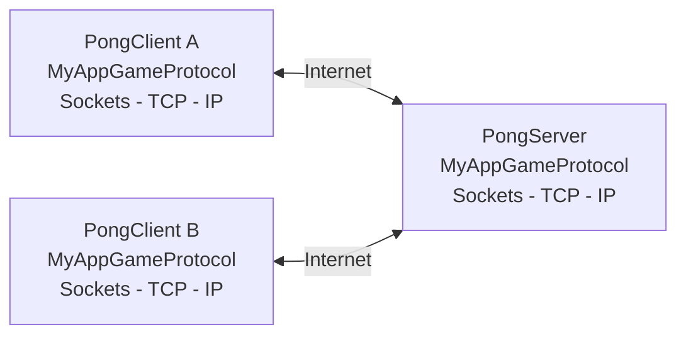
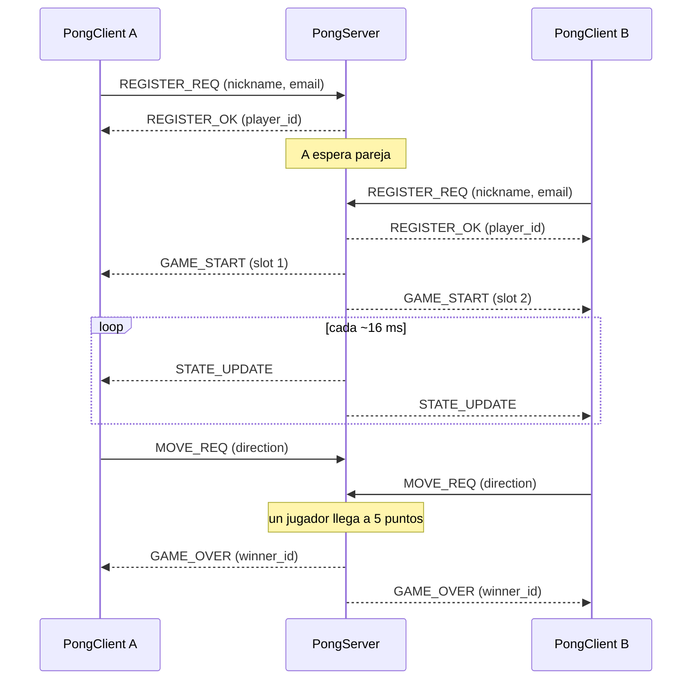

# Pong en línea — Proyecto N1

**Internet: Arquitectura y Protocolos**

**Integrantes:** Juan José Montoya - Miguel Aguilar

---

## 1. Introducción

Juego Pong en red con arquitectura **cliente/servidor**, construido con la API de **sockets Berkeley** y un protocolo binario de capa de aplicación diseñado por el grupo, **MyAppGameProtocol**.

- **PongServer** (C, hilos POSIX): mantiene el estado del juego, empareja jugadores y atiende varias parejas a la vez.
- **PongClient**: versión gráfica en Python con pygame (`client/pong_gui.py`) y versión de terminal en C (`client/pong_client.c`). Ambas usan el mismo protocolo.

El servidor es el único dueño del estado (pelota, paletas, marcador). El cliente solo envía la intención del jugador (subir, bajar, quieto) y dibuja lo que el servidor le informa.

---

## 2. Desarrollo

### 2.1 Arquitectura, compilación y uso



```
protocol/protocol.h   mensajes y funciones de envío/recepción (compartido)
server/server.c       servidor: sockets, hilos, registro, emparejamiento, partidas
server/game.h         reglas del Pong (sin sockets ni hilos)
server/logger.h       logger a consola y archivo
client/pong_gui.py    cliente gráfico (Python + pygame)
client/pong_client.c  cliente de terminal (C)
Makefile
```

Compilar (gcc) y ejecutar:

```bash
make                                   # compila servidor y clientes en C

./server/server <PORT> <LogFile>       # servidor, por ejemplo: ./server/server 9000 log.txt

pip install pygame
python3 client/pong_gui.py             # cliente gráfico: formulario con IP, puerto, nickname y email

./client/pong_client <IP> <PORT> <nickname> <email>   # alternativa: cliente de terminal
```

Controles del cliente gráfico: `W` / `S` (o flechas). Gana quien llegue a 5 puntos.

### 2.2 Tipo de socket: TCP (`SOCK_STREAM`)

- **Fiabilidad y orden:** registro, inicio y fin de partida y errores no pueden perderse ni llegar desordenados; con UDP habría que reimplementar confirmaciones y retransmisiones.
- **Sesión por conexión:** la conexión identifica al jugador y su cierre le indica al servidor que se fue (se avisa al rival).
- **Costo asumido:** UDP tendría menos latencia y toleraría perder un `STATE_UPDATE`, pero para un Pong de dos jugadores con mensajes de 66 bytes el costo de TCP es aceptable (se reduce con `TCP_NODELAY`).

Como TCP es un flujo sin fronteras de mensaje, todos los mensajes miden **66 bytes fijos** y se leen con `recv(..., MSG_WAITALL)`.

### 2.3 Protocolo MyAppGameProtocol

**Servicio.** Permite registrar clientes, emparejarlos, jugar una partida con el servidor como árbitro y terminarla. Es binario, orientado a conexión (TCP) y de longitud fija.

**Formato del mensaje (66 bytes).** Los enteros de 32 bits viajan en orden de red (big-endian).

| Bytes | Campo | Descripción |
|---|---|---|
| 0 | `type` | Tipo de mensaje |
| 1 | `seq` | Secuencia (en `STATE_UPDATE`, contador por partida) |
| 2–65 | `payload` | Datos del mensaje; lo no usado va en cero |

**Vocabulario de mensajes**

| Código | Mensaje | Sentido | Payload |
|---|---|---|---|
| `0x01` | `REGISTER_REQ` | Cliente → Servidor | `nickname[20]`, `email[40]` |
| `0x02` | `REGISTER_OK` | Servidor → Cliente | `player_id` (1 byte) |
| `0x06` | `GAME_START` | Servidor → Cliente | `slot` (1=izquierda, 2=derecha), `opponent_nick[20]` |
| `0x03` | `MOVE_REQ` | Cliente → Servidor | `direction` (0=arriba, 1=abajo, 2=quieto) |
| `0x04` | `STATE_UPDATE` | Servidor → Cliente | `ball_x`, `ball_y`, `paddle1_y`, `paddle2_y` (int32) y `score1`, `score2` (1 byte c/u) |
| `0x05` | `GAME_OVER` | Servidor → Cliente | `winner_id` (1 o 2) |
| `0xFF` | `MSG_ERROR` | Servidor → Cliente | `error_code`: 1 servidor lleno, 2 oponente desconectado, 3 datos inválidos, 4 nickname en uso |

**Reglas de procedimiento**

1. El primer mensaje de toda conexión debe ser `REGISTER_REQ`; si no, el servidor cierra la conexión.
2. El servidor valida (nickname no vacío, email con `@`, nickname no repetido, cupo disponible) y responde `REGISTER_OK` o `MSG_ERROR`.
3. Cuando hay dos jugadores sin partida, el servidor crea una y envía `GAME_START` a ambos.
4. Durante la partida el servidor envía `STATE_UPDATE` unas 60 veces por segundo; el cliente envía `MOVE_REQ` al cambiar de dirección, y esa dirección se mantiene hasta el siguiente `MOVE_REQ`.
5. Al llegar a 5 puntos, el servidor envía `GAME_OVER` a ambos y libera la partida.
6. Si un jugador se desconecta, el servidor envía `MSG_ERROR` (código 2) a su rival y termina la partida.



### 2.4 Servidor: concurrencia y logger

**Concurrencia.** Hilos POSIX: un hilo por cliente (`atender_cliente`: registro, emparejamiento y lectura de sus `MOVE_REQ`) y un hilo por partida (`hilo_partida`: avanza el juego unas 60 veces por segundo y envía el estado). Un `mutex` protege las tablas de clientes y partidas. Soporta 20 clientes a la vez, es decir, hasta 10 partidas simultáneas.

**Logger.** Cada evento se imprime por consola y se escribe en el archivo `<LogFile>` con fecha y hora: conexiones, cada petición recibida, cada respuesta enviada, puntos, errores y fin de partida. Como hay unos 60 `STATE_UPDATE` por segundo, se registra uno por segundo (todos se envían).

```
[2026-10-20 22:32:11] Peticion REGISTER_REQ recibida: nickname=Ana, email=ana@x.com
[2026-10-20 22:32:11] Respuesta REGISTER_OK enviada: player_id=0
[2026-10-20 22:32:11] Partida 0 creada: Ana vs Beto
[2026-10-20 22:32:12] MOVE_REQ de Ana (jugador 1, partida 0): direccion=0
[2026-10-20 22:32:20] Respuesta GAME_OVER enviada (partida 0): gana Ana con marcador 5-0
```

### 2.5 Despliegue en AWS

El servidor corre en una instancia EC2 de AWS Academy con el puerto del juego abierto (TCP 9000) en su Security Group:

```bash
git clone <URL_DEL_REPO> && cd <repo> && make
nohup ./server/server 9000 log.txt &
```

Los clientes se conectan escribiendo la IP pública de la instancia en el formulario.

> _COMPLETAR: IP pública y puerto usados, y una captura del servidor corriendo en AWS con dos clientes conectados._

---

## 3. Conclusiones

- Separar cliente y servidor, con el servidor como único dueño del estado, simplifica los clientes y evita que dos jugadores vean estados distintos.
- Diseñar un protocolo propio obliga a resolver lo que las APIs de alto nivel ocultan: TCP no conserva fronteras de mensaje (de ahí el tamaño fijo y `MSG_WAITALL`), el orden de bytes de los enteros y el relleno de las estructuras en memoria.
- La concurrencia con hilos permite varias parejas a la vez, pero exige proteger con un mutex los datos compartidos.
- Elegir TCP simplificó el diseño a cambio de algo de latencia; UDP sería la alternativa a evaluar en un juego más exigente.

## 4. Referencias

- Brian "Beej" Hall. _Beej's Guide to C Programming_. https://beej.us/guide/bgc/
- Brian "Beej" Hall. _Beej's Guide to Network Programming_. https://beej.us/guide/bgnet/
- GeeksforGeeks. _TCP Server-Client implementation in C_. https://www.geeksforgeeks.org/tcp-server-client-implementation-in-c/
- Wikipedia. _Pong_. https://en.wikipedia.org/wiki/Pong