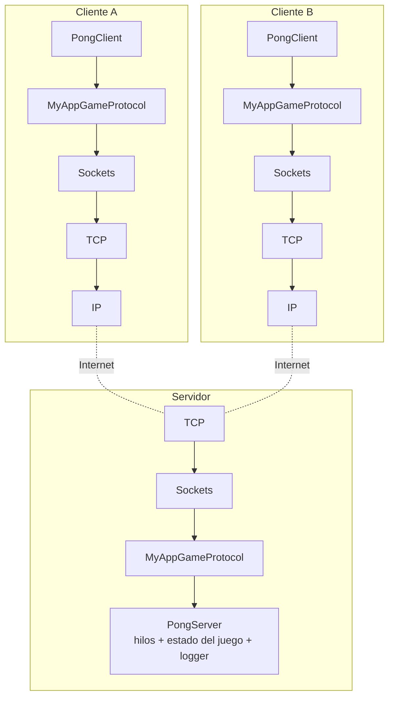
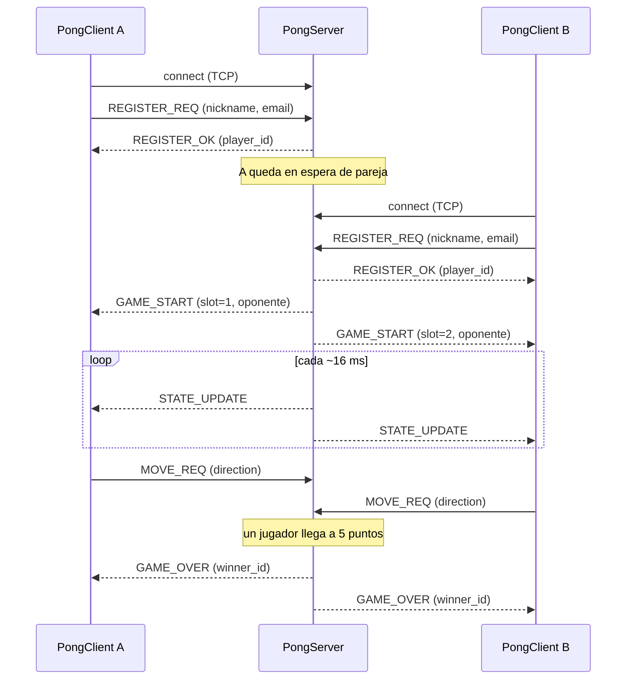
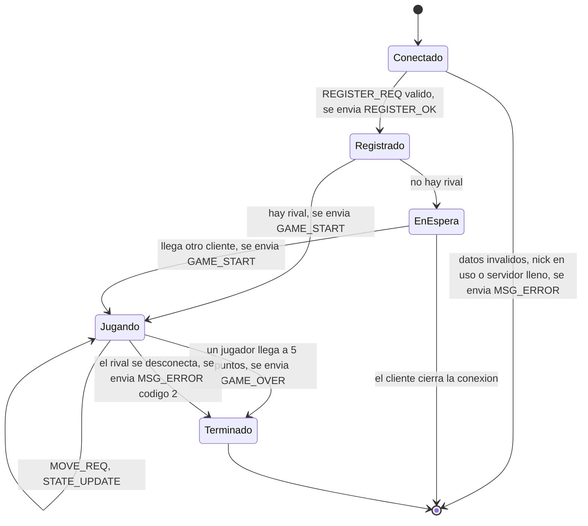

# Pong en línea — Proyecto N1

**Internet: Arquitectura y Protocolos**

Juego Pong en red con arquitectura cliente/servidor, construido sobre la API de sockets Berkeley en C y un protocolo binario de capa de aplicación diseñado desde cero (`MyAppGameProtocol`).

**Integrantes:** _COMPLETAR: nombres completos del grupo (máximo 3)_

---

## 1. Introducción

El objetivo del proyecto es desarrollar habilidades de programación en red, aplicaciones concurrentes y diseño de protocolos. Se implementó:

- **PongServer** (C, sockets Berkeley + pthreads): mantiene el estado del juego, empareja jugadores y atiende varias parejas a la vez.
- **PongClient** con dos versiones que hablan el mismo protocolo: una **gráfica** en Python con pygame (`pong_gui.py`) y una **de terminal** en C (`pong_client.c`) que dibuja el campo en modo texto. Que el cliente esté en un lenguaje distinto al del servidor demuestra que el protocolo, y no el código, es el contrato entre ambos.
- **MyAppGameProtocol**: protocolo binario propio, con mensajes de tamaño fijo, que viaja sobre TCP.

El servidor es el único dueño del estado del juego (posición de la pelota y de las paletas, marcador). Los clientes solo envían la intención del jugador (subir, bajar, quedarse quieto) y dibujan lo que el servidor les informa.

### Estructura del repositorio

```
.
├── Makefile
├── README.md
├── protocol/protocol.h     # Especificación del protocolo hecha código (mensajes, payloads, errores)
├── server/
│   ├── server.c            # Servidor: sockets, hilos, registro, emparejamiento, partidas
│   ├── game.h              # Motor del juego (lógica pura, sin sockets)
│   └── logger.h            # Logger a consola y a archivo, con timestamp
└── client/
    ├── pong_gui.py         # Cliente gráfico (Python + pygame)
    ├── pong_client.c       # Cliente de juego en terminal (C)
    └── test_client.c       # Cliente mínimo para probar solo el registro
```

### Compilación y uso

Requisitos: `gcc` y `make` en Linux o macOS para el servidor y el cliente de terminal (este último usa `termios`; en Windows se puede usar WSL). El cliente gráfico necesita Python 3 y `pip install pygame` (pygame es multiplataforma, por lo que no depende de `termios`).

```bash
make            # compila server/server, client/pong_client y client/test_client
make clean
```

**Servidor**

```bash
./server/server <PORT> <LogFile>
./server/server 9000 log.txt
```

**Cliente gráfico** (recomendado; cada jugador en su computador o en su propia ventana)

```bash
pip install pygame
python3 client/pong_gui.py <SERVER_IP> <PORT> <nickname> <email>
python3 client/pong_gui.py 127.0.0.1 9000 Ana ana@mail.com
```

Controles: `W` o flecha arriba, `S` o flecha abajo; al soltar la tecla, la paleta se detiene. Al terminar la partida se muestra el resultado y se cierra la ventana para salir.

**Cliente de terminal** (alternativa sin dependencias; se recomienda una terminal de al menos 65×28)

```bash
./client/pong_client <SERVER_IP> <PORT> <nickname> <email>
./client/pong_client 127.0.0.1 9000 Ana ana@mail.com
```

Controles: `w` arriba, `s` abajo, espacio quieto, `q` salir. En ambos clientes `<SERVER_IP>` debe ser una dirección IPv4 numérica. Gana quien llegue primero a 5 puntos.

---

## 2. Desarrollo

### 2.1 Arquitectura



Estilo cliente/servidor: el cliente recibe la entrada del usuario y envía un comando; el servidor ejecuta la orden, actualiza el estado y notifica a los dos jugadores de la partida.

### 2.2 Tipo de socket: por qué TCP (`SOCK_STREAM`)

Se eligió **TCP** para todo el tráfico.

- **Fiabilidad y orden.** El registro, el inicio de partida, el fin de partida y los errores no pueden perderse ni llegar desordenados. Con UDP habría que implementar confirmaciones y retransmisiones en la aplicación.
- **Conexión como sesión.** La conexión TCP identifica al jugador durante toda la partida, y su cierre le indica al servidor que el jugador se fue (se avisa al rival). Con UDP habría que construir ese concepto con temporizadores.
- **Simplicidad frente a NAT y cortafuegos.** Un único puerto TCP de entrada en el servidor basta para jugar desde cualquier red.
- **Costo asumido.** UDP daría menor latencia y toleraría perder algún `STATE_UPDATE` (el siguiente reemplaza al anterior). TCP puede retrasar el flujo si se pierde un segmento (_head-of-line blocking_). Para un Pong de dos jugadores con mensajes de 66 bytes, ese costo es aceptable, y se reduce con `TCP_NODELAY` (desactiva el algoritmo de Nagle) en ambos extremos.

Como TCP es un flujo de bytes y no conserva fronteras de mensaje, todos los mensajes tienen **tamaño fijo (66 bytes)** y se leen con `recv(..., MSG_WAITALL)`, de modo que un mensaje partido en varios segmentos se reensambla antes de procesarse.

### 2.3 Especificación del protocolo `MyAppGameProtocol`

**Servicio.** Permite a dos clientes registrarse en un servidor, ser emparejados, jugar una partida de Pong con el servidor como árbitro, y terminarla. El protocolo es binario, orientado a conexión (sobre TCP) y con mensajes de longitud fija.

**Formato del mensaje (66 bytes)**

| Offset | Tamaño | Campo | Descripción |
|---|---|---|---|
| 0 | 1 | `type` | Tipo de mensaje (tabla siguiente) |
| 1 | 1 | `seq` | Número de secuencia (ver abajo) |
| 2 | 64 | `payload` | Datos del mensaje; los bytes no usados van en cero |

Todos los campos de varios bytes (`int32`) viajan en **orden de red (big-endian)**. Las cadenas son ASCII, terminadas en cero y rellenas con ceros. Las estructuras del código están declaradas `packed`, y el compilador verifica los tamaños con `_Static_assert`, de modo que lo que viaja por la red coincide con esta tabla.

**Campo `seq`**

- En `REGISTER_REQ` lo fija el cliente; `REGISTER_OK` repite el `seq` recibido.
- En `STATE_UPDATE` es un contador por partida que arranca en 0 y da la vuelta en 255; permite al cliente detectar actualizaciones desordenadas o repetidas.
- En los demás mensajes no se usa (valor 0).

**Vocabulario de mensajes**

| Código | Nombre | Sentido | Payload (bytes) | Descripción |
|---|---|---|---|---|
| `0x01` | `REGISTER_REQ` | Cliente → Servidor | `nickname[20]` (0–19), `email[40]` (20–59) | Solicita registrarse. Debe ser el primer mensaje de la conexión |
| `0x02` | `REGISTER_OK` | Servidor → Cliente | `player_id` (1 byte) | Registro aceptado |
| `0x06` | `GAME_START` | Servidor → Cliente | `slot` (1 byte: 1=izquierda, 2=derecha), `opponent_nick[20]` | Se encontró rival; empieza la partida |
| `0x03` | `MOVE_REQ` | Cliente → Servidor | `direction` (1 byte: 0=arriba, 1=abajo, 2=quieto) | Fija la dirección de la paleta del jugador |
| `0x04` | `STATE_UPDATE` | Servidor → Cliente | ver tabla siguiente (18 bytes) | Estado completo del juego, unas 60 veces por segundo |
| `0x05` | `GAME_OVER` | Servidor → Cliente | `winner_id` (1 byte: 1 o 2) | Un jugador llegó a 5 puntos; la partida terminó |
| `0xFF` | `MSG_ERROR` | Servidor → Cliente | `error_code` (1 byte) | Error (ver códigos) |

**Payload de `STATE_UPDATE`**

| Offset en payload | Tamaño | Campo |
|---|---|---|
| 0 | 4 | `ball_x` (int32, big-endian) |
| 4 | 4 | `ball_y` (int32, big-endian) |
| 8 | 4 | `paddle1_y` (int32, big-endian) |
| 12 | 4 | `paddle2_y` (int32, big-endian) |
| 16 | 1 | `score1` |
| 17 | 1 | `score2` |

Coordenadas: el campo mide 800×600, el origen (0,0) es la esquina superior izquierda y `y` crece hacia abajo. `paddle_y` es el borde superior de la paleta (de 100 de alto); la pelota es un cuadrado de 10 cuyo `(ball_x, ball_y)` es su esquina superior izquierda.

**Códigos de `MSG_ERROR`**

| Código | Significado | Cuándo |
|---|---|---|
| 1 | Servidor lleno | Ya hay 20 clientes conectados |
| 2 | Oponente desconectado | El rival cerró la conexión durante la partida |
| 3 | Datos inválidos | Nickname vacío o email sin `@` |
| 4 | Nickname en uso | Otro cliente conectado ya usa ese nickname |

**Reglas de procedimiento**

1. El cliente abre una conexión TCP con el servidor y envía `REGISTER_REQ` como primer mensaje. Si el primer mensaje es de otro tipo, el servidor cierra la conexión.
2. El servidor valida los datos. Si son correctos, responde `REGISTER_OK`; si no, responde `MSG_ERROR` (códigos 1, 3 o 4) y cierra la conexión.
3. Si hay un jugador esperando, el servidor crea una partida con ambos y envía `GAME_START` a los dos (el que esperaba es el jugador 1). Si no, el cliente queda en espera.
4. Durante la partida, el servidor envía `STATE_UPDATE` a ambos jugadores en cada ciclo (≈60 por segundo). El cliente envía `MOVE_REQ` cuando el jugador pulsa una tecla; **la dirección se mantiene** (la paleta sigue moviéndose cada ciclo) hasta que llegue otro `MOVE_REQ`.
5. El servidor ignora, dejando constancia en el log, un `MOVE_REQ` con dirección mayor que 2 y un `MOVE_REQ` de un cliente sin partida activa. Los mensajes de tipo desconocido también se ignoran (sin registro).
6. Cuando un jugador llega a 5 puntos, el servidor envía `GAME_OVER` a ambos y libera la partida. Los clientes cierran la conexión.
7. Si un jugador cierra la conexión durante la partida, el servidor envía `MSG_ERROR` (código 2) a su rival y termina la partida. Si cierra mientras espera pareja, simplemente se retira de la espera.

**Diagrama de secuencia**



**Diagrama de estados de un cliente (visto desde el servidor)**



### 2.4 Servidor

**Concurrencia.** Se usan hilos POSIX (`pthread`):

- Un **hilo por cliente** (`atender_cliente`): registra al cliente, lo empareja y luego lee sus `MOVE_REQ`.
- Un **hilo por partida** (`hilo_partida`): cada ~16 ms avanza el estado del juego y envía `STATE_UPDATE` a los dos jugadores.
- Un único `mutex` (`estado_mutex`) protege la tabla de clientes, la tabla de partidas y el cliente en espera. El logger tiene su propio mutex para que las líneas de distintos hilos no se mezclen.

Capacidad: 20 clientes simultáneos (`MAX_CLIENTES`), es decir, hasta 10 partidas a la vez (`MAX_PARTIDAS`). El cliente 21 recibe `MSG_ERROR` código 1.

Como los envíos se hacen con el mutex tomado, cada socket tiene un tiempo máximo de envío de 2 segundos (`SO_SNDTIMEO`): un cliente que deja de leer no puede bloquear indefinidamente a las demás partidas. También se ignora `SIGPIPE` para que escribir en un socket cerrado no mate al servidor.

**Motor del juego** (`server/game.h`). Lógica pura sin sockets ni hilos: movimiento de paletas limitado al campo, rebote de la pelota en los bordes superior e inferior y en las paletas, detección de punto y nuevo saque hacia quien recibió el punto. Parámetros: campo 800×600, paletas 10×100, pelota 10×10, velocidad de pelota 5 px/tick, velocidad de paleta 8 px/tick, 60 ticks por segundo, victoria a 5 puntos.

**Logger** (`server/logger.h`). Cada evento se imprime por consola y se agrega al archivo indicado en `<LogFile>`, con fecha y hora. Se registran: conexiones y desconexiones, cada petición recibida (`REGISTER_REQ`, `MOVE_REQ`), cada respuesta enviada (`REGISTER_OK`, `GAME_START`, `GAME_OVER`, `MSG_ERROR`), los puntos y la creación y el fin de cada partida. Como el servidor envía unos 60 `STATE_UPDATE` por segundo por partida, se **registra solo uno por segundo** (todos se envían igualmente), para que el log siga siendo legible.

Ejemplo de log:

```
[2026-10-20 22:32:11] Peticion REGISTER_REQ recibida: nickname=Ana, email=ana@x.com
[2026-10-20 22:32:11] Respuesta REGISTER_OK enviada: player_id=0
[2026-10-20 22:32:11] Cliente 0 (Ana) en espera de pareja
[2026-10-20 22:32:11] Partida 0 creada: Ana vs Beto
[2026-10-20 22:32:11] Respuesta GAME_START enviada a Ana: slot=1, oponente=Beto
[2026-10-20 22:32:12] MOVE_REQ de Ana (jugador 1, partida 0): direccion=0
[2026-10-20 22:32:13] Partida 0: punto para Ana, marcador 1-0
[2026-10-20 22:32:20] Respuesta GAME_OVER enviada (partida 0): gana Ana con marcador 5-0
```

### 2.5 Clientes

**Cliente gráfico (`pong_gui.py`, Python + pygame).** Un hilo de red recibe `GAME_START`, `STATE_UPDATE`, `GAME_OVER` y `MSG_ERROR` y actualiza el estado compartido (protegido con un `Lock`); el bucle principal dibuja a 60 FPS la red central, las paletas (la propia en verde), la pelota y el marcador. Envía `MOVE_REQ` solo cuando cambia la dirección de la tecla, no en cada fotograma. Reconstruye cada mensaje leyendo exactamente 66 bytes (TCP puede entregarlos partidos) y decodifica el estado con `struct` en orden de red (`!iiiiBB`).

**Cliente de terminal (`pong_client.c`, C).** Usa `select()` para esperar a la vez el teclado y el socket, sin hilos. El terminal se pone en modo sin eco ni búfer de línea para leer teclas sin pulsar Enter, y se restaura al salir. Con cada `STATE_UPDATE` redibuja el campo en ASCII (`|` paletas, `O` pelota, `:` red central), escalando el campo lógico de 800×600 a 60×20 caracteres.

### 2.6 Pruebas realizadas

Se probaron, con dos o más clientes reales contra el servidor (también compilado con AddressSanitizer y UBSanitizer, sin errores reportados):

- Ambos clientes (gráfico y de terminal) contra el mismo servidor.
- Registro correcto, y rechazo por nickname vacío, email sin `@` y nickname repetido.
- Emparejamiento: el primer cliente espera y el segundo dispara `GAME_START` para ambos.
- Partida completa hasta 5 puntos con `GAME_OVER` recibido por ambos clientes, y una segunda partida posterior en el mismo servidor.
- Desconexión de un jugador a mitad de partida: el rival recibe el aviso y el servidor sigue funcionando.
- Que el log registre peticiones, respuestas, puntos y fin de partida (un `STATE_UPDATE` por segundo).

### 2.7 Despliegue en AWS

El servidor se ejecuta en una instancia EC2 de AWS Academy:

1. Crear una instancia Linux y, en su **Security Group**, permitir tráfico de entrada TCP al puerto del juego (por ejemplo 9000) desde `0.0.0.0/0`.
2. Conectarse por SSH, clonar el repositorio y compilar:
   ```bash
   git clone <URL_DEL_REPO>
   cd <repo> && make
   nohup ./server/server 9000 log.txt &
   ```
3. Los clientes se conectan con la IP pública de la instancia:
   ```bash
   python3 client/pong_gui.py <IP_PUBLICA> 9000 <nickname> <email>
   ```

> _COMPLETAR: IP pública / puerto usados y una captura del servidor corriendo en AWS con dos clientes conectados._
>
> Nota: en AWS Academy la IP pública puede cambiar si el laboratorio se reinicia.

### 2.8 Limitaciones conocidas

- Un único mutex global serializa el acceso al estado; para cientos de partidas convendría uno por partida.
- Solo IPv4, y los clientes exigen una IP numérica (no resuelven nombres de dominio).
- No hay reconexión: si un cliente se cae, la partida termina.
- Sin autenticación ni cifrado: el email se envía en claro y no se verifica.
- El cliente de terminal solo funciona en sistemas tipo Unix (usa `termios`); el gráfico no tiene esa limitación.

---

## 3. Conclusiones

- Separar claramente cliente y servidor, con el servidor como único dueño del estado, simplifica la lógica de los clientes y evita que dos jugadores vean estados distintos.
- Diseñar un protocolo propio obligó a pensar en detalles que las APIs de alto nivel esconden: TCP es un flujo sin fronteras de mensaje (de ahí el tamaño fijo y `MSG_WAITALL`), el orden de bytes de los enteros (big-endian en la red) y el relleno de las estructuras en memoria (de ahí `packed` y `_Static_assert`).
- La concurrencia con hilos resuelve el requisito de múltiples parejas simultáneas, pero exige cuidado con los recursos compartidos: un mutex para el estado, otro para el log, y atención a las condiciones de carrera al liberar y reutilizar partidas.
- Elegir TCP simplificó el diseño a cambio de algo de latencia; para un juego más exigente en tiempo real, UDP con un esquema propio de confirmaciones sería la alternativa a evaluar.
- _COMPLETAR (opcional): aprendizajes y dificultades propias del equipo._

## 4. Referencias

- Brian "Beej" Hall. _Beej's Guide to C Programming_. https://beej.us/guide/bgc/
- Brian "Beej" Hall. _Beej's Guide to Network Programming_. https://beej.us/guide/bgnet/
- GeeksforGeeks. _TCP Server-Client implementation in C_. https://www.geeksforgeeks.org/tcp-server-client-implementation-in-c/
- Wikipedia. _Pong_. https://en.wikipedia.org/wiki/Pong
- Páginas de manual de Linux: `socket(2)`, `bind(2)`, `listen(2)`, `accept(2)`, `recv(2)`, `send(2)`, `select(2)`, `tcp(7)`, `pthreads(7)`.
